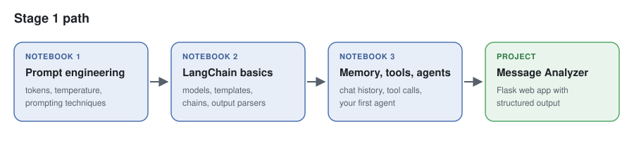
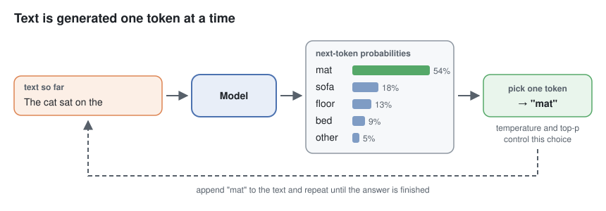

# Stage 1 — LLM Foundations

Learn how to work with a large language model (LLM) from code: how it reads text, how to
write prompts that work, how to build chains and agents with LangChain, and how to turn the
model's answer into data that an app can use.



## What you will learn

- How a chat model reads **tokens** and picks the next word, and what **temperature**,
  **top-k**, and **top-p** change.
- The main prompting techniques: **zero-shot**, **few-shot**, **chain-of-thought**,
  **self-consistency**, and **role prompting**.
- How to reuse prompts with **templates**.
- How to get **structured output** (JSON that follows a schema) instead of free text.
- How LangChain connects models, prompts, and parsers into **chains**.
- How to give an assistant **memory**, let it call **tools**, and build an **agent**.

## Contents

| # | Type | Topic | Status |
| --- | --- | --- | --- |
| 1 | Notebook | [Prompt engineering](01_prompt_engineering.ipynb) | ✅ Ready |
| 2 | Notebook | [LangChain basics](02_langchain_basics.ipynb): models, templates, chains, output parsers | ✅ Ready |
| 3 | Notebook | [Memory, tools, and agents](03_memory_tools_agents.ipynb): chat history, tool calling, your first agent | ✅ Ready |
| – | Project | [Message Analyzer](message-analyzer/): a Flask app with structured output | ✅ Ready |

Work through the notebooks in order. You can build the project after Notebook 1: its README
explains structured output, which Notebook 2 covers in more depth.

## Before you start

```bash
ollama pull gpt-oss:20b   # main model
ollama pull qwen3:1.7b    # small model for some examples
uv sync                   # run in the repo root
```

Open a notebook and select the `.venv` Python kernel. See the [main README](../README.md) for
the full setup.

## The core idea in one picture

An LLM writes **one token at a time**. It scores all possible next tokens, picks one, adds it
to the text, and repeats. Every prompting technique in this stage is a way to steer that loop.



## Key terms

The notebook in brackets is where each term is explained in detail.

### Models and tokens

| Term | Meaning |
| --- | --- |
| **LLM** | A large language model: a neural network trained on huge amounts of text to predict the next token. |
| **Prompt** | The text you send to the model: instructions, data, and examples. (NB 1) |
| **Token** | A small piece of text (a word, part of a word, a digit, or a symbol). Each token has a number, its **id**. Models read and write tokens. (NB 1) |
| **Tokenizer** | The tool that splits text into tokens and turns them into ids. Each model family has its own. (NB 1) |
| **Context window** | The most tokens (prompt + answer) a model can handle at once. (NB 1) |
| **Max tokens** | The most tokens the model may write in one answer. For reasoning models, the thinking counts too. (NB 1) |
| **Sampling** | Picking the next token at random, where likely tokens have a better chance. This is how models usually write. (NB 1) |
| **Temperature** | How random the next-token pick is. Low = stable answers, high = varied answers. (NB 1) |
| **Top-k** | Only the `k` most likely tokens can be picked, for example the top 40. (NB 1) In RAG, "top-k" has a second meaning: how many document pieces a search returns (Stage 2). |
| **Top-p** | Only the most likely tokens, up to a total probability `p`, can be picked. (NB 1) |
| **Greedy decoding** | Always taking the single most likely token, with no randomness. Temperature 0 or `top_k=1` does this. (NB 1) |
| **Seed** | A starting number for the random choices. The same seed and settings give the same answer again. (NB 1) |
| **Reasoning model** | A model that writes out its reasoning ("thinking") before the final answer, such as `gpt-oss`. Ollama returns the thinking apart from the answer. (NB 1) |
| **Hallucination** | When a model states something false or made up as if it were true, such as an invented phone number. (NB 2) |

### Prompting

| Term | Meaning |
| --- | --- |
| **Prompt engineering** | Writing prompts so that the model gives useful answers, in the format you need, every time. (NB 1) |
| **Message roles** | A chat prompt is a list of messages. `system` sets the rules, `user` asks, `assistant` holds the model's earlier answers. (NB 1) |
| **System message** | Instructions for the whole conversation, such as a role or rules. (NB 1) |
| **Zero-shot / one-shot / few-shot** | A prompt with no example / one example / a few examples of the task. (NB 1) |
| **In-context learning** | The model learns a task from examples in the prompt, without any extra training. (NB 1) |
| **Chain-of-thought** | Asking the model to write its steps before the final answer. (NB 1) |
| **Self-consistency** | Asking the same question several times and taking the most common answer. (NB 1) |
| **Role prompting** | Giving the model a role ("You are a teacher for children") to set its tone and depth. (NB 1) |
| **Prompt template** | A prompt with named blanks that you fill for each request. (NB 1, NB 2) |
| **Grounding** | Telling the model to answer only from the text you give it, and to say "I don't know" otherwise. This is the base of RAG. (NB 1) |
| **Structured output** | Model output that must follow a schema, so code can use it as data. (NB 2, project) |
| **JSON schema** | A description of the fields, types, and allowed values that JSON data must have. Pydantic can build one from a Python class. (NB 2, project) |

### LangChain

| Term | Meaning |
| --- | --- |
| **LangChain** | A Python library with building blocks for LLM apps: chat models, prompt templates, parsers, chains, and agents. (NB 2) |
| **Runnable** | Any LangChain building block. Every runnable can be run with `invoke`, `batch`, or `stream`. (NB 2) |
| **Streaming** | Getting the answer piece by piece while the model writes it, so a chat app can show it live. (NB 2) |
| **Chain** | A pipeline of steps (prompt → model → parser) where each output feeds the next step. (NB 2) |
| **LCEL** | LangChain Expression Language: building chains by connecting runnables with the `\|` sign. (NB 2) |
| **Output parser** | Turns the model's text into Python data, such as a string, a list, or a dictionary. (NB 2) |
| **Sequential chain** | Steps that run one after another. Each step adds its result to the data and keeps what was already there (`RunnablePassthrough.assign`). (NB 2) |
| **Parallel chain** | Independent steps that get the same input and run side by side. The result is one dictionary with a key for each step (`RunnableParallel`, or a plain `{...}` dictionary inside a chain). (NB 2) |

### Memory, tools, and agents

| Term | Meaning |
| --- | --- |
| **Memory** | The conversation that the app keeps and sends again, because the model forgets between calls. (NB 3) |
| **Trimmed / summary memory** | Two ways to keep memory short: send only the last messages, or a summary of older messages plus the last ones. (NB 3) |
| **Tool** | A Python function that the model can ask your code to run. (NB 3) |
| **Tool call** | The model's request to run a tool: the tool's name and its arguments. Your code runs the tool and sends the result back. (NB 3) |
| **Agent** | A model that works in a loop: think, call a tool, read the result, repeat until it can answer. (NB 3) |
| **ReAct** | Short for "reason + act": the think → act → observe loop that agents follow. (NB 3) |
| **Checkpointer / thread** | A checkpointer saves an agent's conversation. Each thread is one separate conversation. (NB 3) |
| **Step limit** | The most steps an agent may take before it stops, so it cannot loop forever (`recursion_limit`). (NB 3) |

## Next

➡️ [Stage 2 — RAG fundamentals](../02-rag-fundamentals/): give the model your own documents to
answer from.
