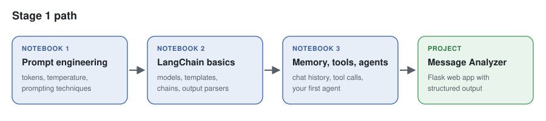
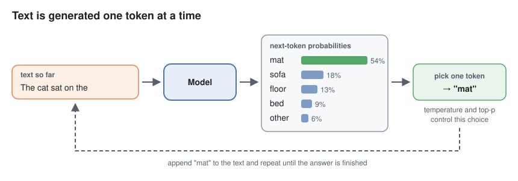

# Stage 1 — LLM Foundations

Learn how to work with a large language model (LLM) from code: how it reads text, how to
write prompts that work, how to build chains and agents with LangChain, and how to turn the
model's answer into data that an app can use.



## What you will learn

- How a chat model reads **tokens** and picks the next word, and what **temperature** and
  **top-p** change.
- The main prompting techniques: **zero-shot**, **few-shot**, **chain-of-thought**,
  **self-consistency**, and **role prompting**.
- How to reuse prompts with **templates**.
- How to get **structured output** (JSON that follows a schema) instead of free text.
- How LangChain connects models, prompts, memory, and tools into chains and agents.

## Contents

| # | Type | Topic | Status |
|---|---|---|---|
| 1 | Notebook | [Prompt engineering](01_prompt_engineering.ipynb) | ✅ Ready |
| 2 | Notebook | LangChain basics: models, templates, chains, output parsers | 🔜 Coming soon |
| 3 | Notebook | Memory, tools, and agents | 🔜 Coming soon |
| – | Project | [Message Analyzer](message-analyzer/): a Flask app with structured output | ✅ Ready |

Work through the notebooks in order. The project only needs Notebook 1.

## Before you start

```bash
ollama pull gpt-oss:20b   # main model
ollama pull qwen3:1.7b    # small model for some examples
uv sync                   # run in the repo root
```

Open a notebook and select the `.venv` Python kernel. See the [main README](../README.md) for
the full setup.

## The core idea in one picture

An LLM writes **one token at a time**. It scores all possible next tokens, picks one, adds it
to the text, and repeats. Every prompting technique in this stage is a way to steer that loop.



## Key terms

| Term | Meaning |
|---|---|
| **LLM** | A large language model: a neural network trained on huge amounts of text to predict the next token. |
| **Token** | A small piece of text (a word, part of a word, a digit, or a symbol). Models read and write tokens. |
| **Context window** | The most tokens (prompt + answer) a model can handle at once. |
| **Temperature** | How random the next-token pick is. Low = stable answers, high = varied answers. |
| **Top-p** | Only the most likely tokens, up to a total probability `p`, can be picked. |
| **System message** | Instructions for the whole conversation, such as a role or rules. |
| **Zero-shot / few-shot** | A prompt with no examples / with a few examples of the task. |
| **Chain-of-thought** | Asking the model to write its steps before the final answer. |
| **Self-consistency** | Asking several times and taking the most common answer. |
| **Reasoning model** | A model that "thinks" in hidden steps before it answers, such as `gpt-oss`. |
| **Prompt template** | A prompt with named blanks that you fill for each request. |
| **Structured output** | Model output that must follow a schema, so code can use it as data. |

## Next

➡️ Stage 2 — RAG fundamentals (coming soon): give the model your own documents to answer from.
