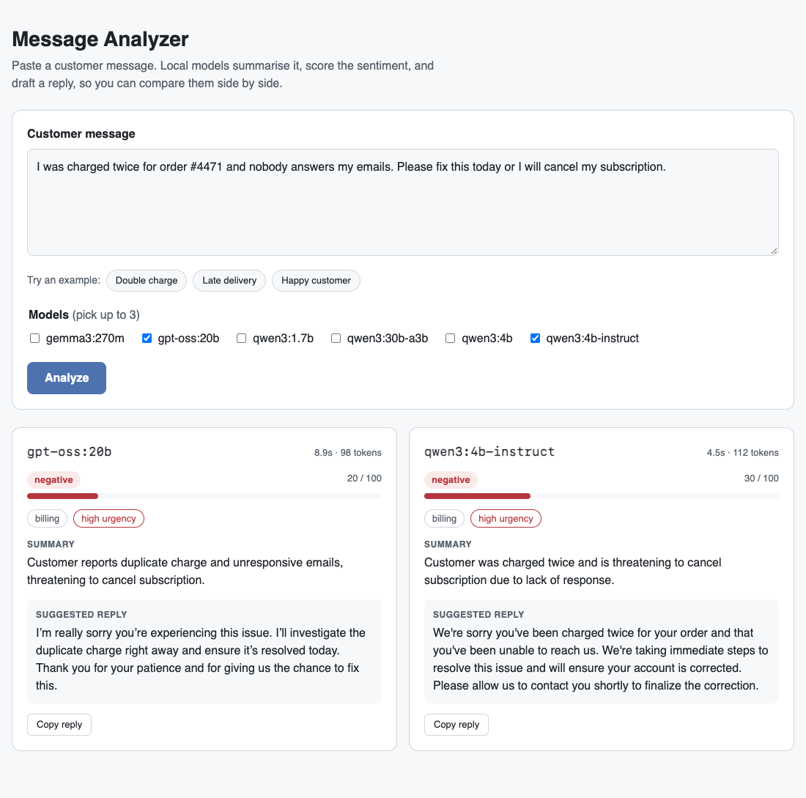
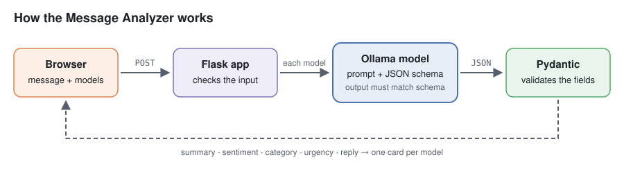

# Message Analyzer

**Stage 1 project.** A small Flask web app for a customer support team. Paste a customer
message, pick one or more local models, and each model returns:

- a one-sentence **summary**,
- the **sentiment** (label and a 0–100 score),
- a **category** (billing, delivery, product, account, other) and an **urgency** level,
- a short **suggested reply**.

The results appear side by side, so you can compare models on speed and quality.



## How it works



1. The browser sends the message and the chosen models to `POST /api/analyze`.
2. Flask checks the input (not empty, not too long, 1–3 models).
3. For each model, [`analyzer.py`](analyzer.py) sends a system prompt and the message to
   Ollama, together with a **JSON schema** built from the `Analysis` class.
4. Ollama makes the model write JSON that matches the schema. Pydantic then checks every field
   (for example, the score must be between 0 and 100).
5. The page shows one card per model.

## The key idea: structured output

In Notebook 1 the model answered with free text. An app needs **data** it can rely on: fields
with fixed names, types, and allowed values. This is called **structured output**.

```python
class Analysis(BaseModel):
    summary: str
    sentiment: Literal["positive", "neutral", "negative"]
    sentiment_score: int = Field(ge=0, le=100)
    category: Literal["billing", "delivery", "product", "account", "other"]
    urgency: Literal["low", "medium", "high"]
    reply: str


response = client.chat(
    model=model,
    messages=messages,
    format=Analysis.model_json_schema(),  # the model must follow this schema
)
analysis = Analysis.model_validate_json(response.message.content)  # checked, typed data
```

Two layers protect the app:

| Layer | What it does |
|---|---|
| `format=` (Ollama) | Limits the model's output so that it is valid JSON with the right fields. |
| Pydantic | Checks types and values. If the check fails, the app shows an error card for that model. |

The prompt still matters. The rules in `SYSTEM_PROMPT` ("2 to 4 sentences", "do not invent
phone numbers or use placeholders like [Name]") made the replies shorter and safer to send.

## Run it

```bash
ollama pull gpt-oss:20b          # plus any other models you want to compare
uv run python 01-llm-foundations/message-analyzer/app.py
```

Open <http://127.0.0.1:5050>. Use `PORT=8000` to change the port.

## API

```bash
curl -X POST http://127.0.0.1:5050/api/analyze \
  -H "Content-Type: application/json" \
  -d '{"message": "Where is my package?", "models": ["gpt-oss:20b"]}'
```

```json
{
  "results": [
    {
      "model": "gpt-oss:20b",
      "seconds": 8.7,
      "output_tokens": 89,
      "summary": "Customer wants to know the location of a delayed package.",
      "sentiment": "negative",
      "sentiment_score": 20,
      "category": "delivery",
      "urgency": "high",
      "reply": "I'm sorry to hear your package hasn't arrived yet. ..."
    }
  ]
}
```

`GET /api/models` lists the installed chat models (embedding models are skipped).

## Project structure

```text
message-analyzer/
├── app.py              # Flask routes and input checks
├── analyzer.py         # prompt, JSON schema, Ollama call, validation
├── templates/index.html
├── static/app.js       # calls the API and draws the cards
├── static/style.css    # light and dark theme
└── tests/              # run without Ollama, using fake clients
```

## Tests

```bash
uv run pytest 01-llm-foundations/message-analyzer
```

The tests replace Ollama with small fake objects, so they run in CI without any model.
