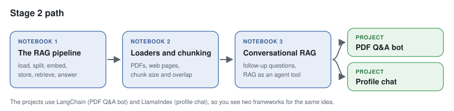
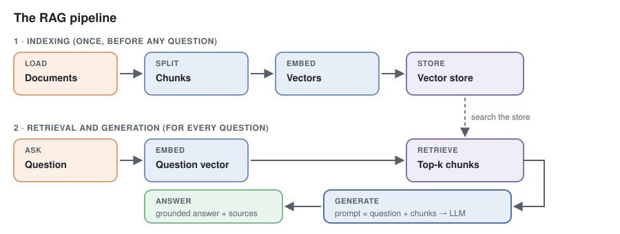

# Stage 2 — RAG Fundamentals

A model only knows what it learned during training. It has never seen your own documents, so
when you ask about them, it guesses. **RAG (Retrieval-Augmented Generation)** fixes this: find
the parts of your documents that match the question, and let the model answer from them.



## What you will learn

- The two phases of RAG: **indexing** (load, split, embed, store) and **retrieval and
  generation** (search, then answer).
- What **embeddings** are and how **similarity search** finds text with the same meaning.
- How to choose **top-k**, show **sources**, and spot when the search fails.
- How to load different file types and how **chunk size** and **overlap** change the results.
- How to handle follow-up questions in a chat, and how to give RAG to an agent as a tool.

## Contents

| # | Type | Topic | Status |
| --- | --- | --- | --- |
| 1 | Notebook | [The RAG pipeline](01_rag_pipeline.ipynb): load, split, embed, store, retrieve, answer | ✅ Ready |
| 2 | Notebook | [Loaders and chunking](02_loaders_and_chunking.ipynb): PDFs, web pages, chunk size and overlap | ✅ Ready |
| 3 | Notebook | Conversational RAG: follow-up questions, RAG as an agent tool | 🔜 Coming soon |
| – | Project | PDF Q&A bot: upload a PDF and ask questions about it (Gradio) | 🔜 Coming soon |
| – | Project | Profile chat: chat about a person's profile (LlamaIndex) | 🔜 Coming soon |

Start with Stage 1 if LangChain chains (`prompt | llm | parser`) are new to you.

## Before you start

```bash
ollama pull gpt-oss:20b        # chat model
ollama pull nomic-embed-text   # embedding model (~270 MB)
uv sync                        # run in the repo root
```

Open a notebook and select the `.venv` Python kernel.

## Sample data

The notebooks use documents from **Brightleaf**, a made-up software company, in
[`data/`](data/). Every name, number, and rule in them is invented.

| File | What it is |
| --- | --- |
| [`handbook.md`](data/handbook.md) | The employee handbook as Markdown (13 sections, about 900 words). |
| [`handbook.pdf`](data/handbook.pdf) | The same text as a 3-page PDF, for the PDF examples. |
| [`it_faq.html`](data/it_faq.html) | A web page with IT help desk questions and answers, including a menu and footer to clean up. |
| [`make_pdf.py`](data/make_pdf.py) | Rebuilds the PDF: `uv run --with fpdf2 python 02-rag-fundamentals/data/make_pdf.py` |

The loaders that read these files are in [`src/roadmap/loaders.py`](../src/roadmap/loaders.py).

## The core idea in one picture



Indexing runs once. Then every question goes through retrieval (find the closest chunks) and
generation (answer from those chunks only).

## Key terms

The notebook in brackets is where each term is explained in detail.

### Retrieval-augmented generation

| Term | Meaning |
| --- | --- |
| **RAG** | Retrieval-Augmented Generation: retrieve the relevant text first, then let the model generate an answer from it. (NB 1) |
| **Indexing** | The preparation phase, done once: load documents, split them, embed the chunks, and store them. (NB 1) |
| **Retrieval** | Finding the chunks that best match a question. (NB 1) |
| **Context** | The retrieved chunks that are put into the prompt for the model to answer from. (NB 1) |
| **Grounding** | Telling the model to answer only from the context, and to say "I don't know" otherwise. Introduced in Stage 1, NB 1. If the rule is too strict, the model refuses answers that are in the context (NB 2). |
| **Hallucination** | When a model states something false or made up as if it were true. RAG with grounding reduces it. (NB 1) |
| **Sources** | The chunks an answer was based on, shown so people can check the answer. (NB 1) |

### Documents and chunks

| Term | Meaning |
| --- | --- |
| **Document** | LangChain's container for text: `page_content` (the text) and `metadata` (facts such as the file name). (NB 1) |
| **Metadata** | Facts about a document, such as its file, page, or section. It is copied into every chunk and used for sources and filters. (NB 2) |
| **Loader** | Code that turns a file, such as a PDF or a web page, into `Document` objects. (NB 2) |
| **OCR** | Optical character recognition: turning an image of text, such as a scanned PDF, into real text. Needed before such files can be loaded. (NB 2) |
| **Chunk** | A small piece of a document. RAG searches over chunks, not whole documents. (NB 1) |
| **Text splitter** | Cuts documents into chunks. The recursive splitter tries paragraphs, then lines, then words, and is the safe default. (NB 2) |
| **Header splitter** | Cuts Markdown at headings and stores the heading text in each chunk's metadata (`MarkdownHeaderTextSplitter`). (NB 2) |
| **Chunk size** | The most characters a chunk may have. Too small loses meaning, too big buries facts; about 500 is a good start. (NB 1, NB 2) |
| **Chunk overlap** | How many characters neighboring chunks share, so a sentence cut in two is not lost. About 10% of the chunk size. (NB 1, NB 2) |

### Embeddings and search

| Term | Meaning |
| --- | --- |
| **Embedding** | A list of numbers (a vector) that represents the meaning of a text. Similar meaning gives similar vectors. (NB 1) |
| **Embedding model** | The model that turns text into embeddings, here `nomic-embed-text` (768 numbers per text). (NB 1) |
| **Cosine similarity** | A score for how similar two vectors are. Higher means closer in meaning. (NB 1) |
| **Vector store** | A database that keeps chunks with their vectors and finds the closest ones to a question. (NB 1) |
| **Retriever** | A runnable that takes a question and returns the most relevant documents. (NB 1) |
| **Top-k (retrieval)** | How many chunks the search returns. Not the same as top-k sampling in [Stage 1](../01-llm-foundations/README.md#models-and-tokens), which limits the next-token choice. (NB 1) |
| **Test set** | Questions with known answers, used to measure a RAG setup instead of guessing. (NB 2) |
| **Hit rate (hit@1)** | The share of test questions where the first retrieved chunk contains the answer. (NB 2) |

## Next

➡️ Stage 3 — Vector databases (coming soon): how similarity search works inside, ChromaDB, and
FAISS.
