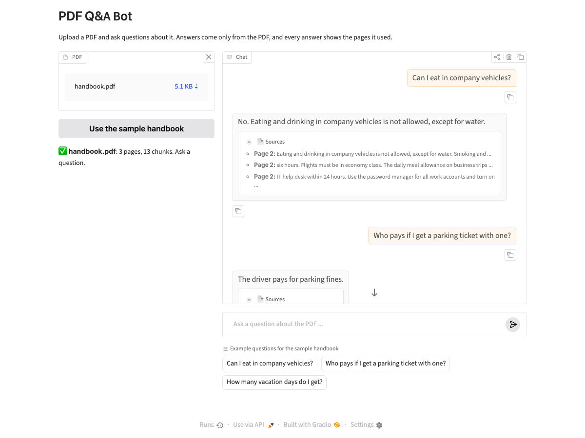
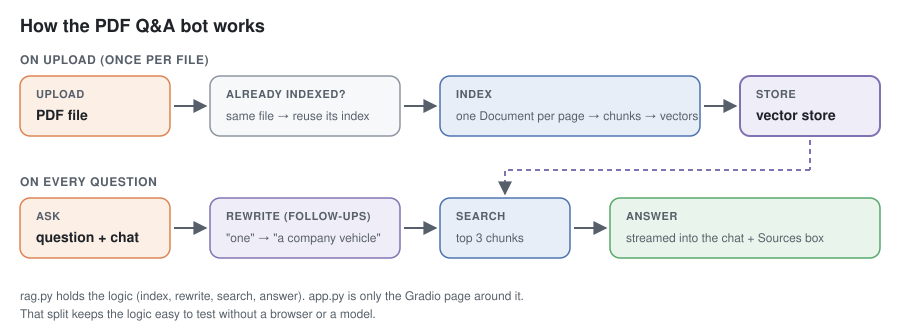

# PDF Q&A Bot

**Stage 2 project.** A small web app: upload a PDF and chat about it. The answers come only
from the PDF, and every answer shows the pages and passages it used, so you can check it.



It puts the three Stage 2 notebooks together:

| Notebook | Used here for |
| --- | --- |
| [1 · The RAG pipeline](../01_rag_pipeline.ipynb) | split, embed, store, retrieve, answer with sources |
| [2 · Loaders and chunking](../02_loaders_and_chunking.ipynb) | `load_pdf()` (one Document per page) and the clear grounding prompt |
| [3 · Conversational RAG](../03_conversational_rag.ipynb) | rewriting follow-up questions, asking back when a question is unclear |

## How it works



1. **Upload.** The app computes a hash of the file. If the same PDF was indexed before, it
   reuses that index; otherwise it loads one Document per page, splits the pages into chunks
   of 500 characters, embeds them, and stores them.
2. **Ask.** For a follow-up question, the model first rewrites it into a standalone question
   (Notebook 3). The first question of a chat is searched as it is.
3. **Search.** The 3 closest chunks are retrieved.
4. **Answer.** The answer streams into the chat word by word, followed by a closed
   **📄 Sources** box with the page number and the start of each chunk.

The source boxes are only for the reader: they are left out of the chat history that goes back
to the model.

## Run it

```bash
ollama pull gpt-oss:20b
ollama pull nomic-embed-text
uv run python 02-rag-fundamentals/pdf-qa-bot/app.py
```

Open <http://127.0.0.1:7860>, then upload a PDF or click **Use the sample handbook**. Use
`PORT=8000` to change the port.

> Scanned PDFs are images and contain no text. The app tells you so instead of failing
> silently (see Notebook 2 on OCR).

## Gradio in five minutes

[Gradio](https://www.gradio.app) builds a web page for a Python function. There are two ways to
use it.

**`gr.Interface`**: one function, its inputs, its outputs. Gradio builds the whole page:

```python
import gradio as gr


def add(a: float, b: float) -> float:
    return a + b


gr.Interface(fn=add, inputs=[gr.Number(), gr.Number()], outputs=gr.Number()).launch()
```

**`gr.Blocks`**: you place the components yourself and connect them with **events**. This app
uses Blocks, because it has two steps (upload, then chat) and some state in between:

```python
with gr.Blocks() as app:
    file_id = gr.State(None)  # per-user value that is not shown on the page
    pdf = gr.File(file_types=[".pdf"], type="filepath")
    status = gr.Markdown()
    chatbot = gr.Chatbot()
    question = gr.Textbox()

    pdf.change(load_pdf_file, inputs=pdf, outputs=[file_id, status, chatbot])
    question.submit(respond, inputs=[question, chatbot, file_id], outputs=[chatbot, question])
```

| Gradio idea | Meaning | In this app |
| --- | --- | --- |
| Component | An input or output on the page | `gr.File`, `gr.Chatbot`, `gr.Textbox`, `gr.Markdown` |
| Event | "When this happens, call that function" | `pdf.change(...)`, `question.submit(...)` |
| `gr.State` | A value kept per browser tab, invisible on the page | the id of the indexed PDF |
| Streaming | A function that `yield`s several times updates the page each time | the answer appears word by word |
| Chat messages | A list of `{"role": ..., "content": ...}` dicts | `gr.ChatMessage(..., metadata={"title": ...})` makes the collapsible Sources box |

## Project structure

```text
pdf-qa-bot/
├── rag.py      # index a PDF, rewrite follow-ups, search, stream the answer (no UI code)
├── app.py      # the Gradio page and its event handlers
└── tests/      # fake models and a fake PdfQA, so no Ollama or browser is needed
```

## Tests

```bash
uv run pytest 02-rag-fundamentals/pdf-qa-bot
```

The tests check that each PDF is embedded only once, that scanned (text-free) PDFs are
rejected, that follow-ups are rewritten and first questions are not, and that the chat shows
the streamed answer followed by the sources.
