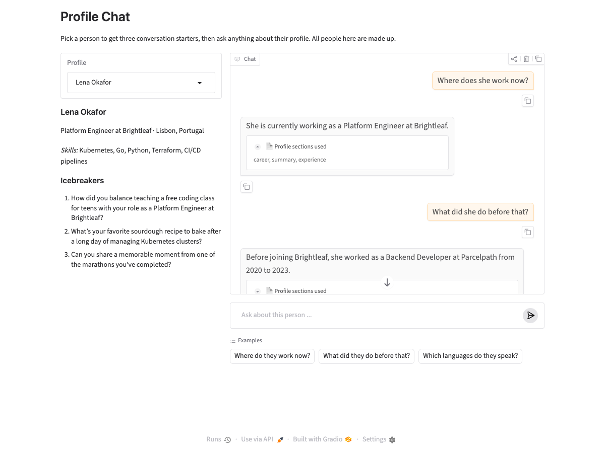
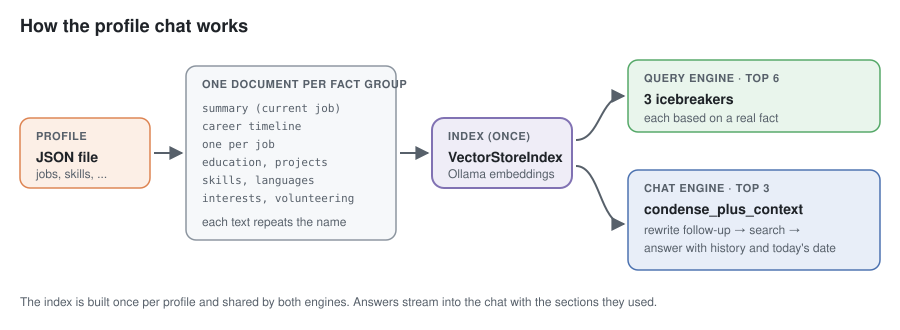

# Profile Chat

**Stage 2 project.** Pick a person, get three conversation starters for meeting them, then ask
questions about their professional profile. The answers come only from the profile, and every
answer shows which profile sections it used. All people here are made up.



The notebooks build RAG with LangChain. This app builds the same idea with a second framework,
[LlamaIndex](https://docs.llamaindex.ai), so you can read and use both.

## How it works



1. **Profile to documents.** Each profile is a JSON file. `profile_to_documents()` turns it into
   small documents, one per fact group: a summary, the career timeline, one per job, education,
   projects, skills, languages, interests, volunteering. Every text repeats the person's name,
   so each one still makes sense when it is found alone.
2. **Index once.** `VectorStoreIndex` embeds the documents with `nomic-embed-text` and keeps
   them in memory. The app builds the index once per profile and reuses it.
3. **Icebreakers.** A **query engine** retrieves the 6 closest documents for "projects, hobbies,
   volunteering, or unusual career steps" and asks the model for three questions, each based on
   one fact.
4. **Chat.** A **chat engine** in `condense_plus_context` mode answers your questions:
   - it rewrites a follow-up ("What did she do before that?") into a standalone question,
     while the first question of a chat is searched as it is,
   - it retrieves the 3 closest documents,
   - it puts them into the system prompt, next to the rules and today's date, and answers with
     the chat history.

   The answer streams into the chat, followed by a closed **📄 Profile sections used** box.
   That box is only for the reader: it is left out of the history that goes back to the model.

## LangChain and LlamaIndex side by side

The RAG steps are the same in both frameworks. Only the names change:

| Step | LangChain (Notebooks 1–3) | LlamaIndex (this app) |
| --- | --- | --- |
| A text with metadata | `Document(page_content=..., metadata=...)` | `Document(text=..., metadata=...)` |
| Split into chunks | text splitter | node parser (the documents here are small, so each stays one chunk, called a **node**) |
| Embed and store | `InMemoryVectorStore` + `OllamaEmbeddings` | `VectorStoreIndex` + `OllamaEmbedding` |
| Search | `as_retriever(search_kwargs={"k": 3})` | `as_retriever(similarity_top_k=3)` |
| Prompt with placeholders | `ChatPromptTemplate` with `{context}` | `PromptTemplate` with `{context_str}` and `{query_str}` |
| Retrieve, then answer one question | a chain: retriever, prompt, model | a **query engine**: `index.as_query_engine()` |
| Chat with follow-up questions | a rewrite chain plus a RAG chain (Notebook 3) | a **chat engine**: `index.as_chat_engine(chat_mode="condense_plus_context")` |

Here is the whole idea in a few lines:

```python
from llama_index.core import Document, VectorStoreIndex
from llama_index.embeddings.ollama import OllamaEmbedding
from llama_index.llms.ollama import Ollama

llm = Ollama(model="gpt-oss:20b", thinking="low", request_timeout=180)
embed_model = OllamaEmbedding(model_name="nomic-embed-text")

documents = [
    Document(text="Lena Okafor lives in Lisbon, Portugal."),
    Document(text="Lena Okafor speaks English, Portuguese, and Igbo."),
]
index = VectorStoreIndex.from_documents(documents, embed_model=embed_model)

# One question, one answer: a query engine.
print(index.as_query_engine(llm=llm, similarity_top_k=1).query("Which languages does Lena speak?"))

# A conversation with follow-ups: a chat engine.
chat = index.as_chat_engine(chat_mode="condense_plus_context", llm=llm, similarity_top_k=1)
print(chat.chat("Where does Lena live?"))  # Lena Okafor lives in Lisbon, Portugal.
print(chat.chat("Which languages does she speak?"))  # "she" is rewritten to "Lena Okafor"
```

## What made the answers right

The first version answered some easy questions wrong. Each fix changed the documents or the
prompt, not the model:

| Question | First answer | Fix |
| --- | --- | --- |
| Where does Lena work now? | "The profile does not say." No single document said which job is the current one. | A **summary** document: "Current job: Platform Engineer at Brightleaf, since 2023." |
| What did she do before that? | The wrong job. Separate job documents have no order. | A **career timeline** document that lists all jobs, newest first. |
| How long has she worked there? | A wrong guess. The model does not know today's date. | Today's date in the system prompt. |
| (icebreakers) | Questions in unbalanced quotation marks. | "without quotation marks" in the icebreaker prompt. |

The lesson: search finds documents one by one. A fact that only appears when you combine
several documents (which job is the newest?) is invisible to it. Write extra documents for the
questions people will ask.

The chat prompt also uses the clear grounding wording from
[Notebook 2](../02_loaders_and_chunking.ipynb): the answer may be a yes or a no or need a small
step of reasoning, and only if the profile does not cover the question does the model say "The
profile does not say."

## Run it

```bash
ollama pull gpt-oss:20b
ollama pull nomic-embed-text
uv run python 02-rag-fundamentals/profile-chat/app.py
```

Open <http://127.0.0.1:7861> and pick a profile. Use `PORT=8000` to change the port.

To add a person, put a new JSON file into [`profiles/`](profiles/) with the same keys as
[`lena_okafor.json`](profiles/lena_okafor.json). The app lists every file in that folder.

## Project structure

```text
profile-chat/
├── profiles/        # two made-up people as JSON files
├── profile_bot.py   # profile to documents, index, icebreakers, chat (no UI code)
├── app.py           # the Gradio page and its event handlers
└── tests/           # LlamaIndex mock models and a fake bot, so no Ollama is needed
```

## Tests

```bash
uv run pytest 02-rag-fundamentals/profile-chat
```

The tests check that every part of a profile becomes a document, that the summary names the
current job, that the timeline lists jobs newest first, that the chat engine gets today's date,
that answers come with their source sections, and that the chat shows the streamed answer
followed by the sections box.
