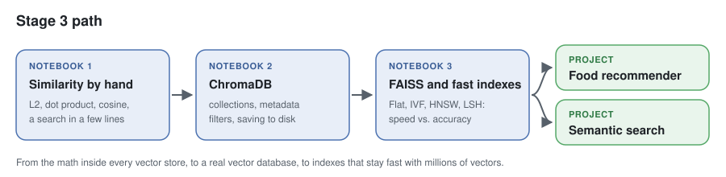

# Stage 3 — Vector Databases

In Stage 2, an in-memory vector store found the chunks closest to a question. That works for
one handbook, but not for millions of chunks that must survive a restart and be filtered by
metadata. This stage looks inside the search: how "close" is measured, how a real vector
database stores and filters vectors, and how indexes keep the search fast as the data grows.



## What you will learn

- Three ways to measure how close two vectors are: **L2 distance**, **dot product**, and
  **cosine similarity**, and why they agree for **normalized** vectors.
- How a similarity search works inside, and why a **brute-force** search gets slow.
- How to store, filter, and update vectors in a **vector database** (ChromaDB).
- How **approximate nearest neighbor (ANN)** indexes trade a little accuracy for a lot of
  speed (FAISS).

## Contents

| # | Type | Topic | Status |
| --- | --- | --- | --- |
| 1 | Notebook | [Similarity by hand](01_similarity_by_hand.ipynb): L2, dot product, cosine, a search in a few lines | ✅ Ready |
| 2 | Notebook | [ChromaDB](02_chromadb_basics.ipynb): collections, metadata filters, saving to disk, RAG with filters | ✅ Ready |
| 3 | Notebook | [FAISS and fast indexes](03_faiss_and_ann_indexes.ipynb): Flat, IVF, HNSW, LSH, speed vs. recall | ✅ Ready |
| – | Project | [Food recommender](food-recommender/): search a canteen menu by meaning, with filters, similar dishes, and a chat (Gradio) | ✅ Ready |
| – | Project | Semantic search with FAISS over a larger dataset | 🔜 Coming soon |

Start with [Stage 2](../02-rag-fundamentals/) if embeddings and vector stores are new to you.

## Before you start

```bash
ollama pull nomic-embed-text   # embedding model (~270 MB)
ollama pull gpt-oss:20b        # chat model, for the RAG examples
uv sync                        # run in the repo root
```

Open a notebook and select the `.venv` Python kernel.

## Sample data

| File | What it is |
| --- | --- |
| [`data/announcements.json`](data/announcements.json) | Twelve made-up Brightleaf announcements from 2024 to 2026, each with a date and a team, for metadata filters. |
| [`../02-rag-fundamentals/data/`](../02-rag-fundamentals/data/) | The employee handbook and IT FAQ from Stage 2. |
| [SQuAD v1.1](https://rajpurkar.github.io/SQuAD-explorer/) | Questions people wrote about Wikipedia articles, an open dataset (CC BY-SA 4.0). Notebook 3 downloads it (about 35 MB), embeds 20,000 questions, and saves everything in `.cache/`. |

The Brightleaf data is made up: every name, date, and rule in it is invented. SQuAD is real,
open data.

## Key terms

The notebook in brackets is where each term is explained in detail.

### Vectors

| Term | Meaning |
| --- | --- |
| **Vector** | A list of numbers. An embedding is a vector. (NB 1) |
| **Dimension** | How many numbers a vector has. `nomic-embed-text` vectors have 768. (NB 1) |
| **Length (norm)** | The square root of the sum of the squared numbers: the distance from zero to the vector's tip. (NB 1) |
| **Normalized vector** | A vector divided by its length, so its length is 1. Also called a unit vector. `nomic-embed-text` returns normalized vectors. (NB 1) |

### Similarity measures

| Term | Meaning |
| --- | --- |
| **L2 distance** | The length of the gap between two vectors (Euclidean distance). 0 means identical; smaller is closer. (NB 1) |
| **Dot product** | The sum of the products of matching numbers. Bigger is closer, but it also grows with the vectors' lengths. (NB 1) |
| **Cosine similarity** | The dot product divided by both lengths: only the angle counts. 1 = same direction, 0 = unrelated, −1 = opposite. (NB 1) |
| **Cosine distance** | 1 − cosine similarity. Many vector databases report this; smaller is closer. (NB 1) |
| **Similarity vs. distance** | A similarity is big for close vectors, a distance is small. Check which one a library returns. (NB 1) |

### Search

| Term | Meaning |
| --- | --- |
| **k-nearest neighbors (k-NN)** | Finding the k vectors closest to a query vector. (NB 1) |
| **Brute-force search** | Comparing the query with every stored vector. Exact, but the time grows with every vector you add. Also called exact or flat search. (NB 1) |
| **Approximate nearest neighbor (ANN)** | A search that looks at only part of the vectors: much faster, but it may miss one of the true top k. (NB 1, NB 3) |
| **Vector database** | A database built for vectors: it stores them with their metadata, filters, saves to disk, and keeps the search fast. (NB 1, NB 2) |

### ChromaDB

| Term | Meaning |
| --- | --- |
| **Client** | Your connection to Chroma: `EphemeralClient` keeps everything in memory, `PersistentClient` saves to a folder. (NB 2) |
| **Collection** | A named set of records, like a table, with one embedding function and one distance measure. (NB 2) |
| **Record** | One stored item: a unique id, the document (text), its embedding, and metadata. (NB 2) |
| **Distance space** | The measure a collection uses: `cosine` (1 − cosine), `ip` (1 − dot product), or `l2` (the squared L2 distance). Always set it yourself. (NB 2) |
| **Metadata filter** | A condition on the metadata (`where`), so only matching records are ranked. It can return fewer than k results. (NB 2) |
| **Text filter** | A condition on the text itself (`where_document`), such as "contains VPN". (NB 2) |
| **Upsert** | Insert a record if its id is new, replace it if the id already exists. (NB 2) |

### Fast indexes (FAISS)

| Term | Meaning |
| --- | --- |
| **FAISS** | An open-source library for fast vector search. It builds indexes, but stores no texts or metadata. (NB 3) |
| **Index** | A structure that stores vectors and searches them. FAISS offers many kinds. (NB 3) |
| **Recall@k** | Of the true k nearest neighbors, the share that an index returns. An exact search has a recall of 1. (NB 3) |
| **Ground truth** | The correct answers to compare against; here, the results of the exact Flat search. (NB 3) |
| **Flat index** | The exact brute-force search inside FAISS (`IndexFlatIP`). (NB 3) |
| **IVF** | Inverted file index: k-means groups the vectors into `nlist` clusters, and a search looks only inside the `nprobe` nearest ones. (NB 3) |
| **k-means** | An algorithm that groups vectors into k clusters around k centers. (NB 3) |
| **Training** | A one-time step some indexes need before vectors are added, such as k-means for IVF. (NB 3) |
| **HNSW** | Hierarchical Navigable Small World: a layered graph that links every vector to its neighbors. A search jumps far on the top layer, then steps to closer neighbors. `M` = links per vector, `efSearch` = candidates kept during a search. Chroma's index. (NB 2, NB 3) |
| **LSH** | Locality-sensitive hashing: random planes turn every vector into a short bit code, and the search compares codes. Very small, but low recall for embeddings. (NB 3) |
| **Hamming distance** | The number of bits that differ between two codes. (NB 3) |

### Building the apps

| Term | Meaning |
| --- | --- |
| **Item-to-item recommendation** | Recommending items like a given one, by searching with that item's own vector. (Food recommender) |
| **Hard filter** | A rule that must always hold, such as "vegan" or "no nuts". It belongs in a metadata filter, not in the question text. (Food recommender) |
| **Index fingerprint** | A short hash of the data and the embedding model, saved with the index, so the app embeds again only when one of them changes. (Food recommender) |

## Next

➡️ Stage 4 — Advanced retrieval (coming soon): better retrievers, hybrid search, reranking,
and measuring retrieval quality.
