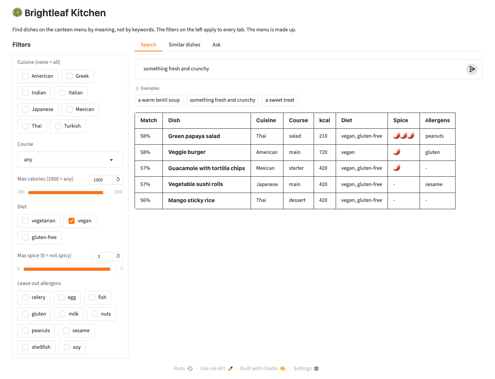
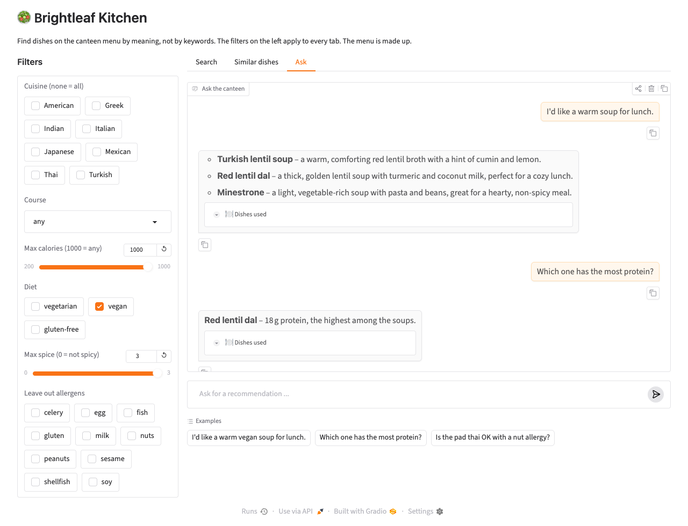
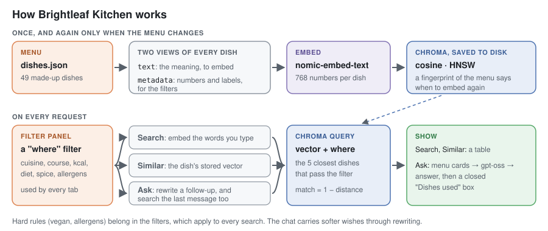

# Food Recommender: Brightleaf Kitchen

**Stage 3 project.** Brightleaf Kitchen is the canteen of Brightleaf, the made-up company from
Stage 2. This app searches its menu by meaning ("something fresh and crunchy"), filters by
cuisine, course, calories, diet, spice, and allergens, finds similar dishes, and recommends
dishes in a chat. The menu is made up.



| Tab | You | The app |
| --- | --- | --- |
| **Search** | describe what you feel like eating | shows the closest dishes that pass the filters, with a match score |
| **Similar dishes** | pick a dish | shows the dishes whose vectors are closest to that dish's own vector |
| **Ask** | chat | rewrites follow-up questions and recommends dishes from the matching ones only |

The filters on the left apply to all three tabs. Here the vegan filter is on, so "a warm soup"
only finds vegan soups, and the follow-up keeps that context:



## How it works



1. **Two views of every dish.** `dish_text()` writes what a dish *means* (name, description,
   ingredients, spice, diet), and only that is embedded. `dish_metadata()` keeps the facts a
   filter needs: cuisine, course, calories, diet flags, spice level, and one true/false field
   per allergen (`has_nuts`, `has_milk`, ...), because Chroma metadata only takes simple
   values. Numbers stay out of the embedding: a search cannot tell 380 from 830 calories, a
   filter can.
2. **Embedded once.** The dishes go into a Chroma collection saved in `chroma_db/`. The
   collection stores a fingerprint of the menu and the embedding model, so the app embeds the
   menu again only when one of them changes.
3. **One filter for every tab.** The filter panel becomes a Chroma `where` filter:

   ```python
   Filters(vegan=True, max_calories=400, avoid=("nuts",)).where()
   # {"$and": [{"calories": {"$lte": 400}}, {"vegan": True}, {"has_nuts": False}]}
   ```

4. **Similar dishes** embed nothing new: they search with the dish's own stored vector and
   skip the dish itself. This is called **item-to-item** recommendation.
5. **Ask** finds the matching dishes, gives them to `gpt-oss` as menu cards, and streams the
   answer, followed by a closed **🍽️ Dishes used** box. The prompt says to take every number
   from the menu cards, and to name a dish's allergens instead of calling it safe for an
   allergy. When the filters leave no dish at all, the app answers with a fixed sentence and
   does not call the model.

## What made the answers right

| Problem | What happened first | Fix |
| --- | --- | --- |
| "Which one has the most protein?" after asking for vegan soups | The rewrite became "Which soup has the most protein?", and the model once suggested chicken ramen. | One example in the rewrite rule ("after 'I want a vegan curry', 'Is there a spicy one?' becomes 'Is there a spicy vegan curry?'") keeps earlier wishes. |
| The same follow-up | The model once answered "20 g protein" for a soup with 18 g: that dish was not in the prompt, so it answered from memory. | A follow-up also searches the user's previous message, so the dishes from the last answer stay in the prompt with their real numbers. |
| Hard rules over a long chat | A rewrite can still drop a wish. | Rules that must always hold (vegan, allergens) belong in the filters, which apply to every search. |

One more thing to know about searching by meaning: without filters, "something warm and
comforting for a cold day" puts the mango lassi, a cold drink, at the top, tied with a warm
lentil soup. The embedding matched the word "cold". Embeddings capture meaning, but single
words still pull, so look at the results, not just the scores.

## From the notebooks

| Notebook | Used here for |
| --- | --- |
| [Stage 3 · 1 · Similarity by hand](../01_similarity_by_hand.ipynb) | the match score is the cosine similarity: 1 − Chroma's cosine distance |
| [Stage 3 · 2 · ChromaDB](../02_chromadb_basics.ipynb) | a saved collection, metadata filters with `$and`, `$in`, `$lte` |
| [Stage 3 · 3 · FAISS](../03_faiss_and_ann_indexes.ipynb) | Chroma searches with HNSW; with 49 dishes any index answers at once |
| [Stage 2 · 3 · Conversational RAG](../../02-rag-fundamentals/03_conversational_rag.ipynb) | rewriting follow-up questions before the search |

## Run it

```bash
ollama pull gpt-oss:20b
ollama pull nomic-embed-text
uv run python 03-vector-databases/food-recommender/app.py
```

Open <http://127.0.0.1:7862>. Use `PORT=8000` to change the port. The first start embeds the
menu (about a second) and saves it in `chroma_db/`. Delete that folder to start fresh; after a
change to [`data/dishes.json`](data/dishes.json), the menu is embedded again by itself.

## Project structure

```text
food-recommender/
├── data/dishes.json   # 49 made-up dishes with diet flags, spice level, and allergens
├── recommender.py     # menu -> Chroma, filters, search, similar dishes, chat (no UI code)
├── app.py             # the Gradio page and its event handlers
└── tests/             # fake models and temporary Chroma folders, so no Ollama is needed
```

## Tests

```bash
uv run pytest 03-vector-databases/food-recommender
```

The tests check that the menu data is consistent (a vegan dish is also vegetarian, "gluten-free"
matches the allergens), that filters turn into the right `where`, that searches only return
dishes that pass the filters, that the menu is embedded once and again after a change, that a
search with no matching dish skips the model, and that follow-ups search the rewrite and the
previous message.
