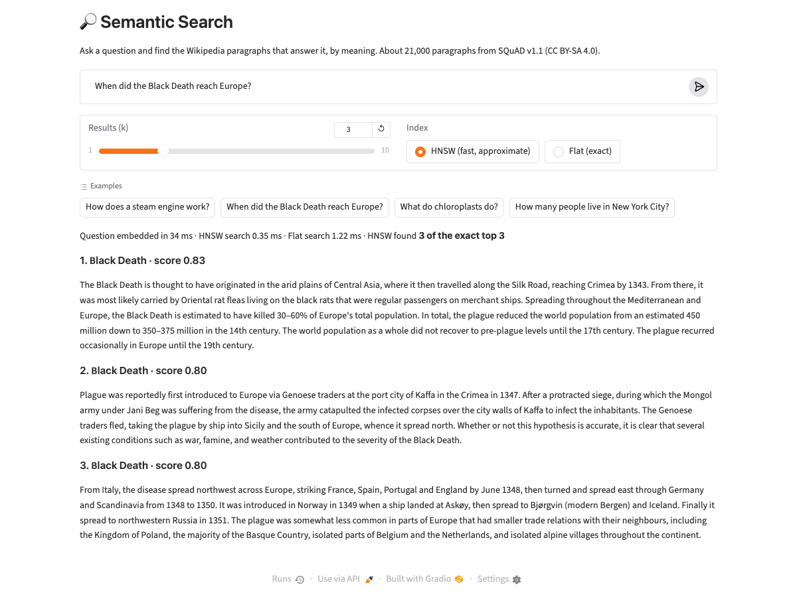
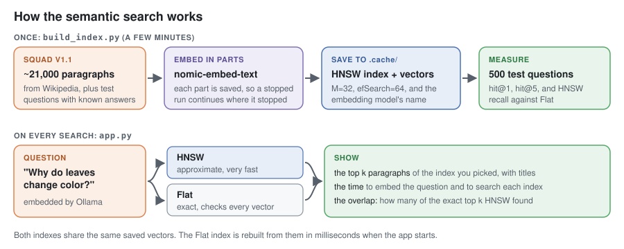

# Semantic Search

**Stage 3 project.** Ask a question and find the Wikipedia paragraphs that answer it, by
meaning, among about 21,000 paragraphs. Every search runs on a FAISS **HNSW** index and, for
comparison, on an exact **Flat** index, so you can see what the fast index gains and what it
loses.



## How it works



1. **Build once.** `build_index.py` downloads SQuAD v1.1 (the same files as Notebook 3, kept
   in `../.cache/`) and embeds all 20,963 paragraphs. It works in parts of 1,024 paragraphs
   and saves each part in a folder named after the embedding model, so a stopped run
   continues where it stopped, and never mixes vectors from two models. Then it builds an HNSW
   index (`M=32`, `efSearch=64`) and saves the vectors, the index, the paragraphs, and the
   name of the embedding model in `.cache/`. On our machine this takes about 4 minutes; the
   HNSW index itself takes 0.6 seconds. The paragraphs are embedded as they are: embedding
   models read punctuation and numbers, so there is no cleaning step.
2. **Search.** The app loads the saved files (about a third of a second, including a new Flat
   index built from the saved vectors), embeds your question, and searches both indexes.
   It shows the top k paragraphs of the index you picked, the time each step took, and how
   many of the exact top k the HNSW index found.
3. **Out-of-date protection.** If you change the embedding model in `.env`, the saved
   vectors no longer fit. The app notices it from the saved model name and asks you to run
   `build_index.py` again.

## How good is the search?

SQuAD says which paragraph answers each of its development questions, so they make a test set
(the idea from [Stage 2, Notebook 2](../../02-rag-fundamentals/02_loaders_and_chunking.ipynb)).
`build_index.py` measures the search on 500 of them:

| Measure | Result | Meaning |
| --- | --- | --- |
| hit@1 | 62.4% | the right paragraph comes first |
| hit@5 | 81.2% | the right paragraph is in the top 5 |
| recall@5 | 98.7% | the HNSW index finds almost all of the exact top 5 |

"The right paragraph" is a strict test: often another paragraph of the same article answers
the question too. And the HNSW index costs almost nothing in quality: its misses are rare.

## Where the time goes

A typical search on our machine:

| Step | Time |
| --- | --- |
| Embed the question with Ollama | about 10 ms (the first one is slower) |
| HNSW search | about 0.2 ms |
| Flat search | about 1 to 2 ms |

With 21,000 paragraphs you wait for the embedding, not for the index. The index choice starts
to matter with millions of vectors, as the scaling chart in
[Notebook 3](../03_faiss_and_ann_indexes.ipynb) shows.

## When the answer is not in the data

"Who painted the ceiling of the Sistine Chapel?" returns three paragraphs about mosaics, with
scores around 0.63, while good matches score around 0.8. A search always returns k results,
even when none of them fits. A low score is a hint that the data does not cover the question;
Stage 4 shows how to drop weak matches.

## From the notebooks

| Notebook | Used here for |
| --- | --- |
| [Stage 3 · 1 · Similarity by hand](../01_similarity_by_hand.ipynb) | normalized vectors, so the inner product is the cosine similarity |
| [Stage 3 · 3 · FAISS](../03_faiss_and_ann_indexes.ipynb) | HNSW and Flat indexes, recall@k, saving and loading an index |
| [Stage 2 · 2 · Loaders and chunking](../../02-rag-fundamentals/02_loaders_and_chunking.ipynb) | a test set and hit@k |

## Run it

```bash
ollama pull nomic-embed-text
uv run python 03-vector-databases/semantic-search/build_index.py   # once, about 4 minutes
uv run python 03-vector-databases/semantic-search/app.py
```

Open <http://127.0.0.1:7863>. Use `PORT=8000` to change the port. The app needs no chat model.

The index lives in `.cache/` next to the app (about 145 MB). Delete it any time; the app then
asks you to run `build_index.py` again.

## Data

The paragraphs come from [SQuAD v1.1](https://rajpurkar.github.io/SQuAD-explorer/), an open
dataset of questions about Wikipedia articles (license: CC BY-SA 4.0). The paragraphs are
Wikipedia text.

## Project structure

```text
semantic-search/
├── search.py        # load SQuAD, embed, HNSW and Flat indexes, search, evaluate, save/load
├── build_index.py   # the one-time build: embed in parts, save, measure on 500 questions
├── app.py           # the Gradio page
└── tests/           # a tiny SQuAD-shaped file and fake embeddings, so no Ollama is needed
```

## Tests

```bash
uv run pytest 03-vector-databases/semantic-search
```

The tests check that SQuAD files are read with their titles and test questions, that texts are
embedded in small batches, that a paragraph finds itself first, that the evaluation counts hits
correctly, that a saved index loads with the same results, and that an index built with another
embedding model is refused.
