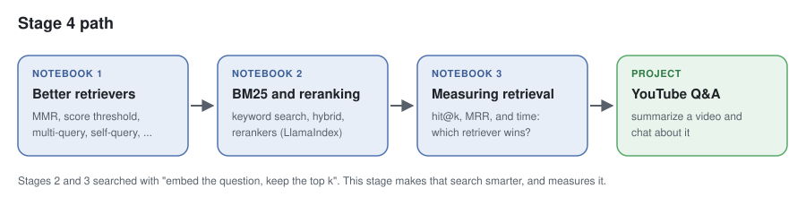

# Stage 4 — Advanced Retrieval

Stages 2 and 3 searched the same way every time: embed the question, keep the k closest
chunks. That works often, but not always. Copies fill the top k, unrelated chunks come back
when nothing fits, questions use other words than the documents, filters hide inside the
question, and exact terms get blurred by embeddings. This stage makes the search smarter, and
measures whether each change really helps.



## What you will learn

- Five smarter retrievers, each built in a few lines with LCEL: **MMR**, a **score
  threshold**, **multi-query**, **self-query**, and **parent document**.
- Keyword search with **BM25**, **hybrid search**, and **reranking**.
- How to measure retrieval with **hit@k** and **MRR**, and weigh quality against time.

## Contents

| # | Type | Topic | Status |
| --- | --- | --- | --- |
| 1 | Notebook | [Better retrievers](01_better_retrievers.ipynb): MMR, score threshold, multi-query, self-query, parent document | ✅ Ready |
| 2 | Notebook | [Keyword search, hybrid search, and reranking](02_llamaindex_retrievers.ipynb): BM25, hybrid search, auto-merging, two rerankers | ✅ Ready |
| 3 | Notebook | [Measuring retrieval](03_retrieval_evaluation.ipynb): a test set, hit@k, MRR, and time for six methods on two datasets | ✅ Ready |
| – | Project | YouTube Q&A: summarize a video and chat about it (Gradio) | 🔜 Coming soon |

Start with [Stage 2](../02-rag-fundamentals/) and [Stage 3](../03-vector-databases/) if
retrievers and Chroma are new to you.

## Before you start

```bash
ollama pull nomic-embed-text   # embedding model
ollama pull gpt-oss:20b        # chat model
uv sync                        # run in the repo root
```

Notebooks 2 and 3 also download a small cross-encoder model (about 90 MB) from Hugging Face
the first time they run; no account is needed. Open a notebook and select the `.venv` Python
kernel.

## Sample data

The notebooks reuse Brightleaf's made-up knowledge base: the employee handbook and IT FAQ
from [Stage 2](../02-rag-fundamentals/data/), and the company announcements from
[Stage 3](../03-vector-databases/data/).

Notebook 3 also tests on the development set of **SQuAD v1.1** (license: CC BY-SA 4.0):
questions that people wrote about Wikipedia paragraphs. It downloads the file (about 5 MB)
once into `.cache/`.

## Key terms

The notebook in brackets is where each term is explained in detail.

### Smarter retrievers

| Term | Meaning |
| --- | --- |
| **MMR** | Maximal marginal relevance: picks results one by one, each close to the question **and** different from the ones already picked. `lambda_mult` sets the balance (1 = only relevance), `fetch_k` the number of candidates. (NB 1) |
| **Near-duplicates** | Chunks with (almost) the same text, for example when the same file was indexed twice. They waste places in the top k. (NB 1) |
| **Relevance score** | A score where higher means closer. For a cosine store it is the cosine similarity. (NB 1) |
| **Score threshold** | Drops every result whose relevance score is below a limit, so the result can be empty. No limit separates good and bad matches perfectly; keep it low and measure. (NB 1) |
| **Multi-query** | The model writes the question in other words; every version is searched, and each chunk is kept once. Helps when questions and documents use different words. (NB 1) |
| **Self-query** | The model splits the question into a topic and metadata filters ("IT", "2026"), and the search uses both. (NB 1) |
| **Parent document** | Search small pieces for a precise match, then give the model the whole section (the parent) each piece came from. (NB 1) |

### Keyword search, hybrid search, and reranking

| Term | Meaning |
| --- | --- |
| **Dense retrieval** | Search with embeddings: every chunk is a vector, and closeness means similar meaning. Finds other wordings, but blurs exact numbers, codes, and names. (NB 2) |
| **Sparse retrieval** | Search with the words themselves, no embeddings. **BM25** is the common method. (NB 2) |
| **BM25** | Scores a chunk by the question's words it contains: rare words count more than common ones, each extra repeat adds less, and shorter chunks get a small bonus. Strong for exact terms like "4400". (NB 2) |
| **Hybrid search** | Runs a dense and a sparse retriever and merges their lists, so both kinds of questions are covered. (NB 2) |
| **Reciprocal rank fusion (RRF)** | Merges ranked lists by position, not by score: each list gives a chunk `1 / (60 + rank)`, and the parts are added up. (NB 2) |
| **Hierarchical nodes** | The same text cut into several levels, from large parents to small **leaves**. (NB 2) |
| **Auto-merging** | Searches only the leaves; when enough leaves of one parent come back, it returns the parent instead. An automatic parent document retriever. (NB 2) |
| **Candidate set** | The short list from the first, fast search. A reranker only reorders this list. (NB 2) |
| **Reranking** | A second pass that reads the question and each candidate **together** and reorders the candidate set. (NB 2) |
| **Cross-encoder** | A small model trained to score how well a passage answers a question. Fast, but can be fooled by shared words. (NB 2) |
| **LLM reranker** | A chat model scores the candidates. Slower, but it understands other wordings better. (NB 2) |

### Measuring retrieval

| Term | Meaning |
| --- | --- |
| **Test set** | Questions whose right chunk you know. Here each question comes with a short phrase that only the right chunk contains. (NB 3) |
| **hit@k** | The share of questions whose right chunk is somewhere in the top k results. hit@3 matters most when the top 3 chunks go into the prompt. (NB 3) |
| **MRR** | Mean reciprocal rank: the average of 1 / rank of the right chunk, with 0 when it is missing. Rewards a high place. (NB 3) |
| **SQuAD** | An open dataset of questions that people wrote about Wikipedia paragraphs. Here the second test set: each question's paragraph is its right chunk. (NB 3) |

## Next

➡️ Stage 5 — Multimodal (coming soon): speech to text, text to speech, image generation, and
vision models.
